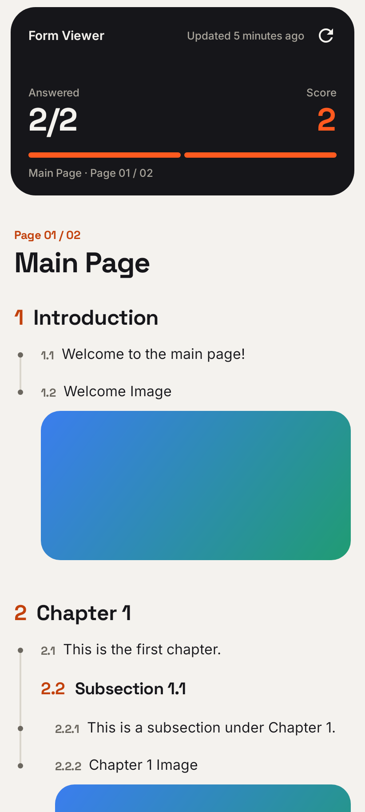
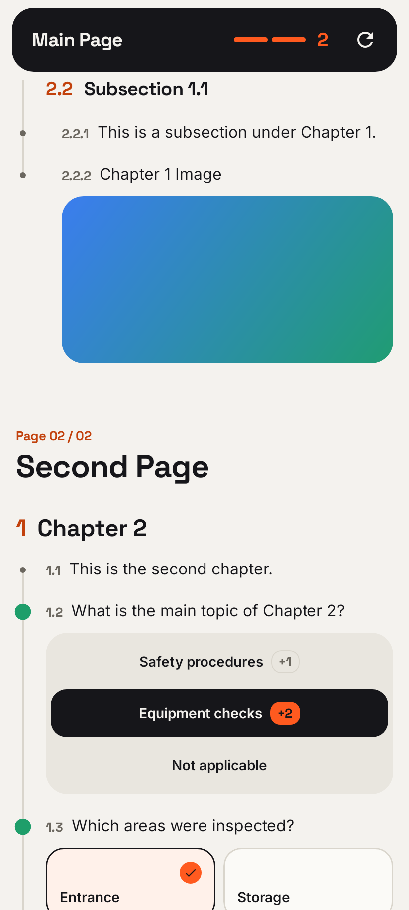
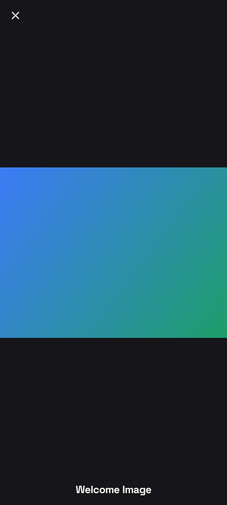
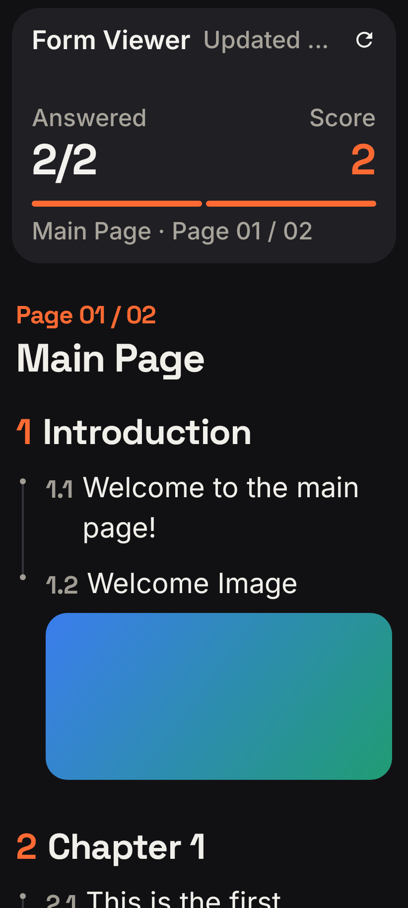
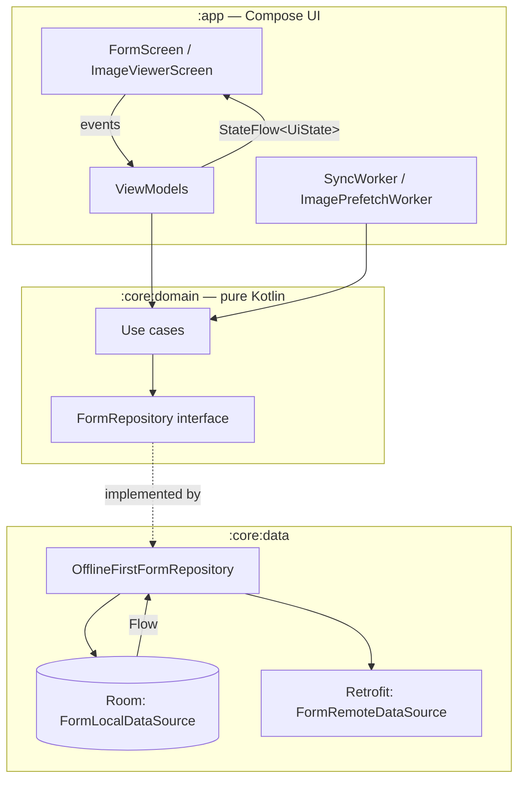

# Lumiform Form Viewer

A native Android app (Kotlin, Jetpack Compose) that fetches a hierarchical form definition from a JSON endpoint and
renders it as one readable, answerable screen. It works offline: the form and your answers live in a Room (SQLite)
database, which is the single source of truth for the UI.

| Form | Choice questions | Image viewer | Dark, 200 % font |
|---|---|---|---|
|  |  |  |  |

All images above are generated by the screenshot tests (see [Testing](#testing)); the full matrix is in
[`app/src/test/screenshots`](app/src/test/screenshots).

## Features

- **Hierarchy you can read at a glance.** Pages, sections nested to any depth and questions, with font size decreasing
  from page to section depth to question (one mapping in `HierarchyTypography`), outline numbering (`2`, `2.1`,
  `2.1.1`) and a timeline rail per group.
- **Text questions** show their content; **image questions** show a reduced-size thumbnail (decoded at the size it is
  drawn) that opens a full-screen viewer with the full-size image and its title.
- **Image viewer:** the thumbnail grows into the full image (shared-element transition). Double-tap zooms, pinch zooms
  and pans; pinching below 1× or swiping the image away closes it, as do the close button and system back.
- **Choice questions:** single select is a segmented track whose thumb slides to the answer (re-tap clears it); multi
  select is a grid of check tiles. Scores show as `+2` badges, and the header sums answered questions and score.
- **Offline first:** the screen always renders what is in the database. Syncs merge the new form into it without losing
  answers; images are cached on disk and prefetched on Wi-Fi.
- **Poor connections (bonus):** retries with backoff, HTTP revalidation (ETag → 304), background sync with WorkManager
  (periodic and when the network comes back), pull-to-refresh, an offline status in the header, and a snackbar when a
  refresh fails while saved data stays on screen.
- **Unknown item types never crash the app:** they render an "update the app" card, and known questions nested inside
  them still show.
- **Show item ids:** a display setting (header → settings) shows each item's raw id from the JSON next to it, for
  checking the rendering against the source. Off by default and remembered with DataStore.
- **Certificate pinning** on both GitHub hosts, with a blocking screen if the connection may be intercepted.
- Light and dark theme, adaptive layout for phones, foldables and tablets, TalkBack labels and Accessibility Test
  Framework checks in CI.

## Setup

Requirements: a recent Android Studio that supports Android Gradle Plugin 9.4, with the Android SDK for API 37, and a device or emulator
on Android 8.0 (API 26) or later. No JDK setup is needed: `gradle/gradle-daemon-jvm.properties` makes Gradle run on
JDK 21 and download it if it is missing.

```bash
git clone https://github.com/Beretta299/LumiformTestAssignment.git
cd LumiformTestAssignment
./gradlew installDebug
```

Or open the folder in Android Studio and run the `app` configuration. No API keys or local configuration are needed;
Android Studio writes `local.properties` with your SDK path.

### Useful commands

```bash
./gradlew testDebugUnitTest :core:domain:test   # all JVM and Robolectric tests
./gradlew verifyRoborazziDebug                  # compare screenshots with the committed ones
./gradlew recordRoborazziDebug                  # re-record them after an intended UI change
./gradlew spotlessApply                         # format (ktlint)
./gradlew spotlessCheck lint                    # static analysis
```

## Architecture

Three Gradle modules with Clean-ish layering and unidirectional data flow:



- **`:core:domain`** is a plain Kotlin/JVM module, so the compiler guarantees no Android types leak into the models
  (a sealed `FormItem` tree), repository interfaces and use cases. ViewModels only talk to use cases.
- **`:core:data`** holds the network DTOs (the only place with serialization annotations), Room entities and DAOs, pure
  mappers and the offline-first repository.
- **`:app`** holds Compose screens, ViewModels, navigation, WorkManager workers and Hilt entry points.

**Data flow.** The UI observes the form through a `Flow` from one `@Transaction` Room query. A sync (on app start
through WorkManager, on pull-to-refresh, on Retry, periodically and when the network returns) fetches the JSON and
merges it into the database in one transaction; the screen updates because the database changed. A tap on an answer
writes to the database through `ToggleResponseUseCase`, and the selection shown is always the stored one.

**Rendering.** The tree is flattened into rows (node + depth) off the main thread and shown in one `LazyColumn` with
stable keys and content types, instead of nested composables, so long forms stay smooth.

## Design decisions and trade-offs

| Decision | Why | Trade-off |
|---|---|---|
| Room, fully normalised (`form_item` self-referencing tree, `response_set`, `response`, `answer`, `sync_metadata`) | The brief asks for a relational database; answers reference responses by foreign key, so the database keeps them consistent | More mapping code than storing the JSON blob |
| Sync **merges** instead of replace | A wipe-and-insert would cascade-delete the user's answers. Removed responses drop their answers via FK cascade; a multi → single-select change clears that question | Merge logic needs careful tests (DAO + repository tests cover it) |
| A malformed known item rejects the whole payload | A partial parse followed by a merge would delete items and answers; failing keeps the cached form intact | One bad item blocks updates until the server is fixed |
| Selection rule (`toggleSelection`) is a pure domain function applied inside a DB transaction to the stored set | Two quick taps or a tap racing a sync never act on a stale screen | — |
| Item ids are hidden by default, with a setting to show them | They mean nothing to a user; numbering (`2.1`) gives a reference instead. Ids are still the list keys, primary keys and navigation argument | The setting lives in Preferences DataStore, not Room: it isn't form data and shouldn't share the form's schema migrations |
| Images: lazy loading + prefetch on unmetered networks into Coil's disk cache in `filesDir` | Offline images without spending mobile data; `filesDir` isn't cleared by the system like `cacheDir` | The LRU cache can still evict; a hard guarantee needs own file storage |
| Image viewer is a real navigation destination (`ImageDestination(questionId)`) that looks like a pop-up | The brief asks for a new screen; only the id travels and the viewer reads Room, so it survives process death | Navigation adds a dependency for a two-screen app |
| Certificate pinning via Network Security Config with CA-level SPKI pins, backups and an expiration date | Covers Retrofit and Coil in one place; CA pins survive GitHub's leaf rotation; expiry avoids bricking old installs | Pins must be reviewed before `2027-04-21` |
| WorkManager handles the launch sync | An app started offline syncs as soon as the network returns, with no connectivity callback of our own | — |
| Own visual language ("Field") on Material 3 Expressive | Stock Material looked like a component demo; one accent colour and bundled fonts give a calm, form-focused look | Material 3 is on `1.5.0-beta02` for the Expressive APIs |

The full list of decisions, with the reasoning behind each, is in [`docs/DECISIONS.md`](docs/DECISIONS.md).

### Assumptions about the data

- Item ids are unique across the whole form; response ids are a separate id space. Both hold for the sample.
- `score` may be missing or `null`; both mean "not scored" (`Score.NotScored`).
- Display text (titles, content) is optional; the UI shows a neutral fallback.

## Testing

| Layer | What | How |
|---|---|---|
| Parsing and network | Real payload fixture, unknown types, missing fields, HTTP errors, retries, HTTP cache, pin rejection over real TLS | JUnit 5, MockWebServer, okhttp-tls |
| Domain | Selection rule table, every use case | JUnit 5 over fakes (pure JVM) |
| Database | DAOs, merge sync, cascades, answer reconciliation | Room in-memory on Robolectric |
| Repository | Offline-first behaviour, sync state, failures keep the cache | Fake remote + in-memory Room, Turbine |
| Mappers | DTO → rows → domain round trips, ordering | JUnit 5 |
| ViewModels | State transitions, refresh errors with and without cache, selection | coroutines-test |
| Background work | Scheduling policy, worker results, prefetch | work-testing on Robolectric |
| UI | Every row type, taps, states, image viewer gestures (double-tap, swipe, pinch-out) | Compose UI tests on Robolectric |
| Zoom gestures | Zoom around the finger, pan bounds, dismiss thresholds | Pure JUnit 5 (`ZoomMath`) |
| Screenshots | Light/dark × font scale 1.0/1.5/2.0 × small phone, phone, landscape, foldable, tablet, plus every state | Roborazzi |
| Accessibility | Contrast, touch targets, labels, duplicate descriptions | ATF via Roborazzi |

Everything runs on the JVM, so the whole suite runs in CI without an emulator. The screenshot and accessibility tests
already paid off: they caught header text clipped at 200 % font size, accent-coloured numbers below WCAG contrast and
an image label TalkBack would have read twice.

## Continuous integration

[`.github/workflows/ci.yml`](.github/workflows/ci.yml) runs on every pull request and push to `main`: `spotlessCheck`,
`lint`, all unit and Robolectric tests, `verifyRoborazziDebug` and a debug build (the APK is uploaded as an artifact;
reports and screenshot diffs are uploaded on failure).

## Future work

- Uploading answers: the `answer` table already has a `sync_state` column for an outbox; it needs a real endpoint.
- Instrumented end-to-end test (launch → go offline → relaunch → cached form and answers) and a Room migration test
  once the schema has a second version.
- Own file storage for images if offline images must be guaranteed rather than cached.
- Code coverage (Kover) in CI, Macrobenchmark and Baseline Profiles.
